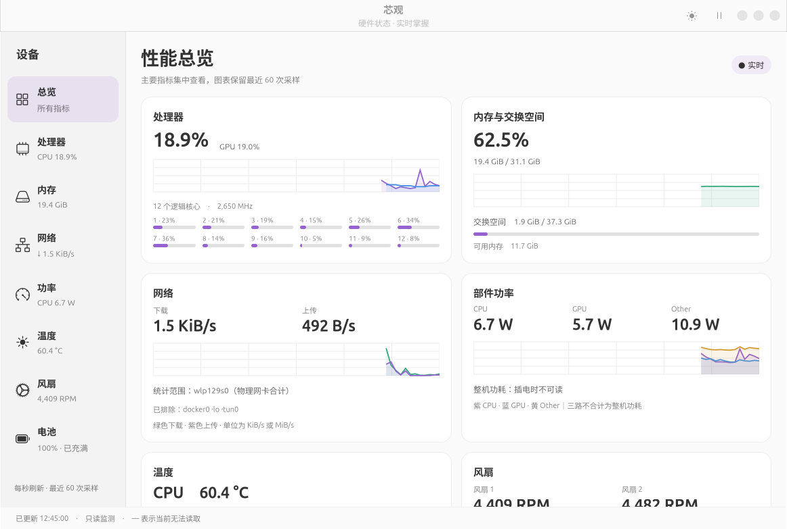
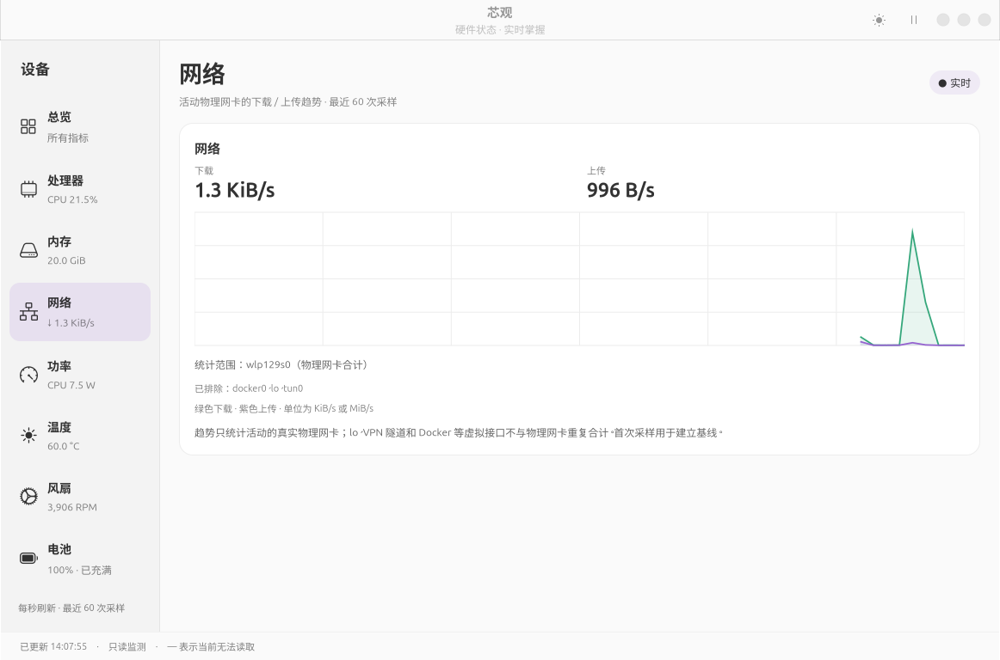

# 芯观 · Xinguan

一个为 Linux 笔记本准备的**中文、只读**硬件监控面板，界面参考 Mission Center。
为 Ubuntu 24.04 ARM64 上的摩尔线程 AIBOOK / M1000 编写并实测，使用 GTK 4 + libadwaita。

[](https://github.com/chengminhua/xinguan/releases)
[](LICENSE)
[](#运行要求)



## 功能

- **总览**：CPU、GPU、内存、网络、功率、温度、风扇、电池集中查看。
- **处理器**：CPU 总占用、12 个逻辑核心分别占用、平均频率、GPU 占用。
- **内存**：物理内存、可用内存、交换空间。
- **网络**：活动物理网卡的下载 / 上传速率与最近 60 次采样曲线。
- **功率**：PM01 / PM02 / PM00 三路部件功率，分别显示为 CPU / GPU / Other。
- **温度**：CPU / GPU 命名温度与系统温区；功率保护字段不会被当作温度。
- **风扇**：两路风扇实时 RPM。
- **电池**：电量、状态、电压、电流与供电来源。
- 每秒刷新、暂停 / 恢复、浅色 / 深色切换，窗口标题与应用名为“芯观”。



## 数据边界

这个项目宁可显示“—”，也不猜数据。

- **插电时不显示整机总功耗。** 本机没有可靠的整机总功率接口，界面明确显示“插电时不可读”。
- **三路功率不能相加。** CPU、GPU、Other 分别是 PM01、PM02、PM00；Other 是厂商定义的其他部件功率，不是“其余全部耗电”。
- **电池侧估算有严格前提。** 只有确认所有已知外部供电断开、单块系统电池正在放电且读数有效时，才用电压 × 电流（或 `power_now`）显示“电池侧整机估算”。充满时的残余电流不会被当作整机功耗。
- **网络只统计物理网卡。** `lo`、VPN 隧道、Docker 等虚拟接口不与底层物理网卡重复合计；首次采样只建立基线，计数器重置时显示“—”。
- **风扇只读。** 本机没有 `pwm` / `pwm_enable` / 目标转速接口，`mthreads-smi` 也没有调速命令，因此不提供风扇滑块，也不写 `/sys` 风扇接口。
- **缺失不等于零。** 任何读不到的指标显示“—”，而不是 0。
- **只读。** 不修改功率策略、不写 sysfs、不设置开机自启、不上传数据；关闭窗口即停止采集。

完整说明见 [docs/使用说明.md](docs/使用说明.md)。

## 运行要求

| 项目 | 要求 |
| --- | --- |
| 系统 | Ubuntu 24.04 ARM64（aarch64），已在 AIBOOK / M1000 实测 |
| 桌面 | GTK 4.14+、libadwaita 1.5+ |
| Python | 3.10+，含 PyGObject、pycairo、psutil |
| GPU 数据 | 可选，依赖设备自带的 `mthreads-smi` |

其他 ARM64 Linux 发行版理论上可用，但未验证；x86_64 上界面和通用指标可以运行，GPU / 功率等厂商数据不可用。

## 从源码运行

```bash
sudo apt update
sudo apt install python3-gi python3-gi-cairo python3-cairo python3-psutil \
                 gir1.2-gtk-4.0 gir1.2-adw-1
git clone https://github.com/chengminhua/xinguan.git
cd xinguan
./scripts/run.sh
```

也可以直接执行 `python3 src/app.py`。程序强制使用 Cairo 渲染（`GSK_RENDERER=cairo`），以适配本机图形环境。

把入口安装到当前用户（写入 `~/.local/share/applications`，并链接 `~/.local/bin/xinguan`）：

```bash
./scripts/install-user.sh
./scripts/uninstall-user.sh   # 撤销
```

## 安装发布包

从 [Releases](https://github.com/chengminhua/xinguan/releases) 下载
`芯观-<版本>-Ubuntu24.04-ARM64.zip`，解压后执行：

```bash
cd 芯观-*-Ubuntu24.04-ARM64
bash 安装芯观.sh
```

安装脚本会校验 SHA256、检查系统，再通过 `apt` 安装 deb 及缺失依赖。也可以手动：

```bash
sha256sum -c SHA256SUMS.txt
sudo apt install ./xinguan_*_arm64.deb
```

卸载：`sudo apt remove xinguan`。发布包不包含驱动、厂商工具或运行库。

## 测试

```bash
python3 -m unittest discover -s tests -v
```

- `tests/test_metrics.py`：27 项供电、温度、风扇与缺失数据边界测试。
- `tests/test_network.py`：4 项网络基线、虚拟接口过滤与计数器重置测试。

测试使用临时 sysfs 目录和模拟计数器，不读写真实硬件。

## 构建发布包

需要 `dpkg-deb`，建议安装 `desktop-file-utils`：

```bash
python3 scripts/build_release.py
```

产物在 `dist/`：ZIP、其中的 ARM64 deb、`安装芯观.sh`、中文说明和 `SHA256SUMS.txt`，并生成同名 `.sha256` 校验文件。版本号只在 `VERSION` 文件中维护。

## 项目结构

```
src/app.py            GTK 4 / libadwaita 界面与图表
src/metrics.py        只读数据采集层（proc / sysfs / psutil / mthreads-smi）
src/check_runtime.py  发布包运行依赖检查
tests/                边界与回归测试
scripts/run.sh        从源码启动
scripts/install-user.sh / uninstall-user.sh
scripts/build_release.py
packaging/            deb 内容模板、启动器、桌面入口
assets/               图标与截图
docs/使用说明.md      面向使用者的完整说明
```

数据来源：

| 指标 | 来源 |
| --- | --- |
| CPU、内存、交换、网络 | `/proc/stat`、`psutil` |
| GPU 占用、CPU / GPU 温度 | `mthreads-smi -q cpu gpu`（后台线程，约 3 秒一次） |
| 部件功率 | `/sys/bus/acpi/devices/ACPI000D:*/power1_average` |
| 系统温区 | `/sys/class/thermal/thermal_zone*/temp` |
| 风扇 | `/sys/class/hwmon/hwmon*/fan*_input` |
| 电池与外部供电 | `/sys/class/power_supply/*` |

## 已知限制

- 只在 AIBOOK / M1000 上验证过；不同机型的传感器名称、功率映射可能不同。
- 插电整机功耗不可读，这是当前接口的限制，不是界面缺项。
- 风扇只有转速，没有可用的调速接口。
- 应用 ID 仍为 `local.ahua.HardwarePanel`，与早期本机安装保持兼容；安装到其他系统时不影响功能。
- 短时测试约三分钟，不代表长期稳定性保证；实测单核 CPU 占用约 1.8%，RSS 约 200–220 MiB。

## 参与贡献

欢迎提交 Issue 和 PR。请先阅读 [CONTRIBUTING.md](CONTRIBUTING.md)，尤其是“数据边界”一节：不要为了界面好看而伪造整机功耗、风扇控制或缺失读数。

## 许可证

[GPL-3.0-or-later](LICENSE)。第三方依赖（GTK、libadwaita、PyGObject、psutil 等）遵循各自许可证，本项目不重新分发它们。

## 致谢

- 界面布局参考 [Mission Center](https://missioncenter.io/) 的侧栏与卡片思路。
- 功率测量范围参考[摩尔线程官方功率说明](https://docs.mthreads.com/e300/version-1.5.0/e300-doc-online/boot_system_config/power_capping/)。
